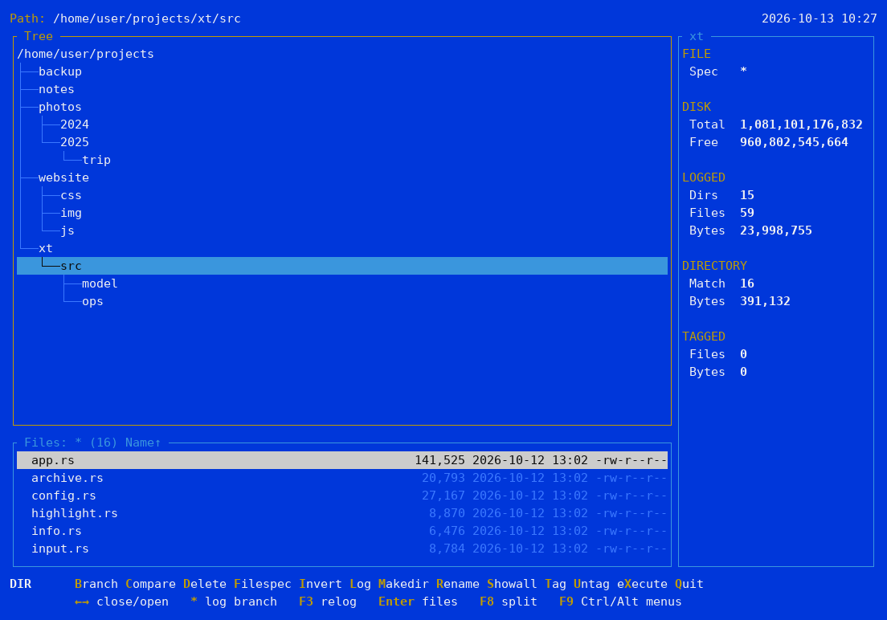
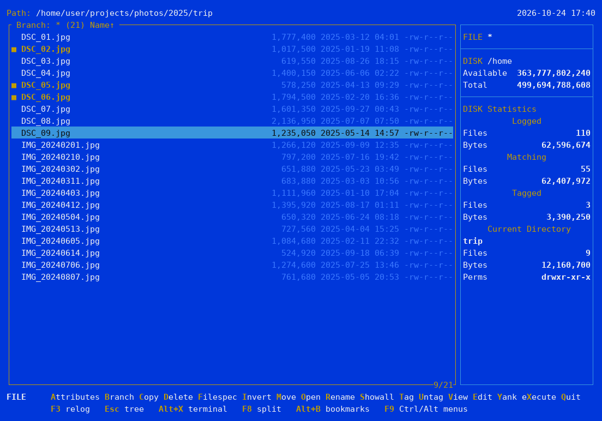
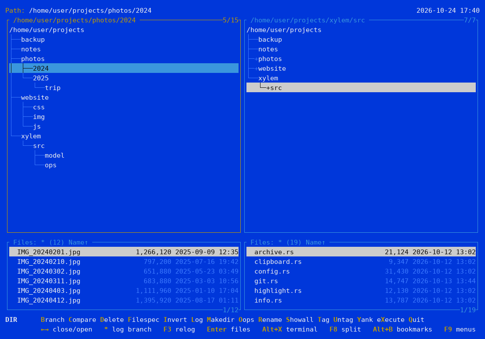
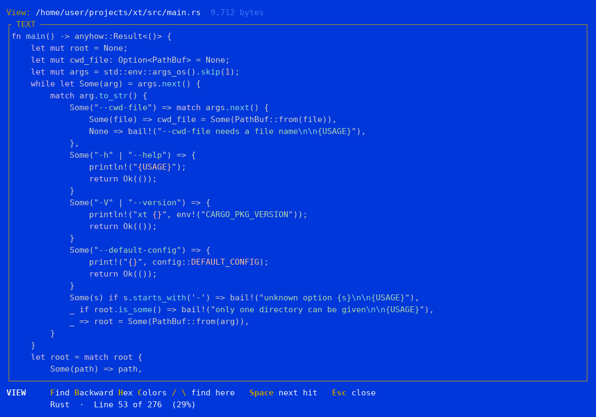
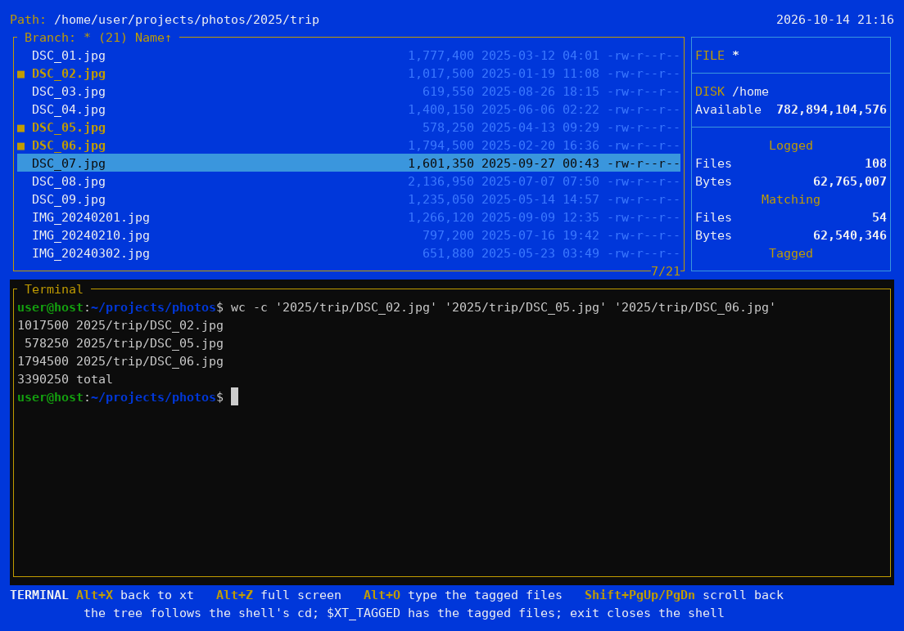
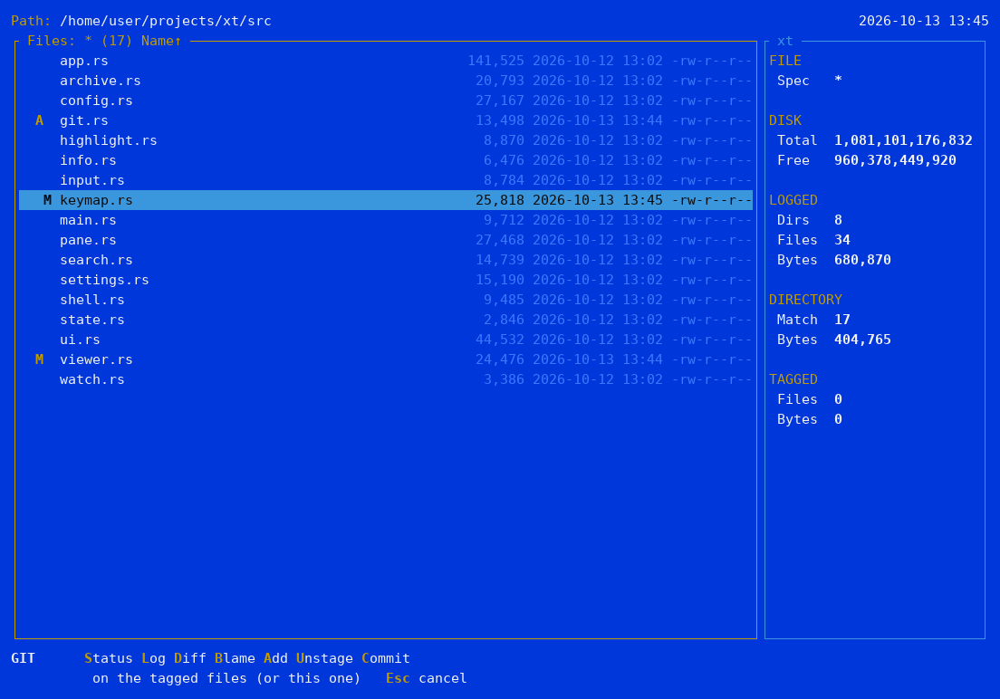
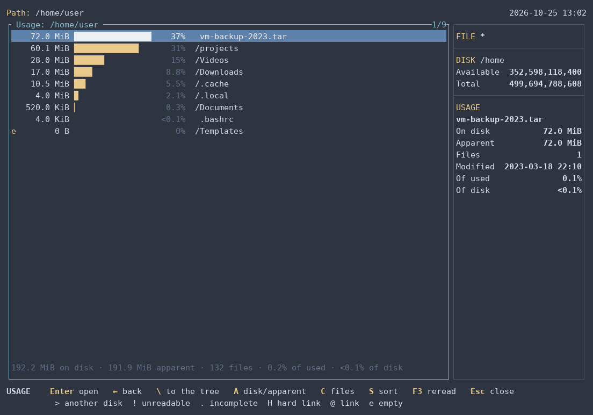
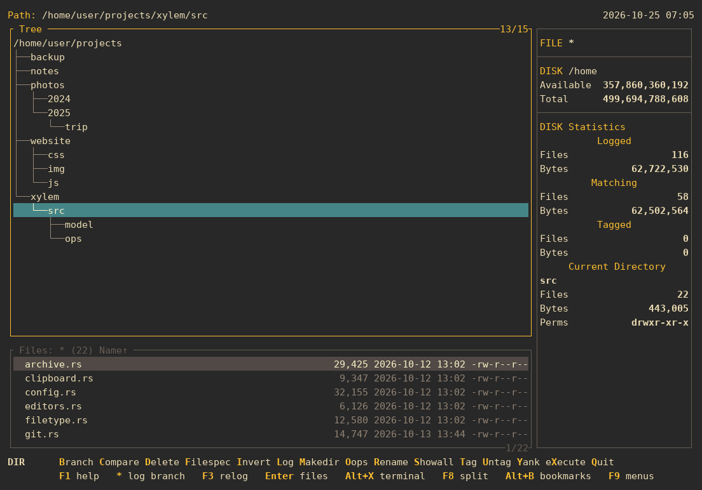

# Xylem

[Leia em português](README.pt-BR.md)

Text-mode file manager for Linux, inspired by XTree and ZTreeWin.

Xylem was called **xt** until version 0.1; the command is now `xy`. On its
first run it moves xt's configuration, history and bookmarks to its own
folders. The name: the xylem is the tissue that carries water through a
tree, and it starts with an X, like XTree.


## Why Xylem?

I have used some flavor of XTree since the 1990s, and ZTreeWin is still, to
me, the best text-mode file manager there is. I wrote Xylem because I missed
something as good as it running on Linux: the existing alternatives seem
abandoned or have drifted too far from the classic look and feel.

As much as I like ZTreeWin, its development is extremely slow. That is why Xylem
will probably get a Windows version too.

Xylem follows ZTreeWin's keys and way of working whenever possible; the
differences are listed in [Comparison with ZTreeWin](docs/manual/ztreewin.md).

## Disclaimer

Xylem is an independent project, written from scratch. It is not affiliated
with, endorsed by or connected to Zedtek, Inc. (ZTreeWin) or to the owners of
XTree. It contains no code from those programs; their names are mentioned only
to describe what inspired Xylem and how it compares. XTree, ZTree and ZTreeWin
are trademarks of their respective owners.

## Screenshots

The directory tree, the file window and the statistics, in the classic theme:



**Branch** (`B`) lists the files of a whole branch; tagged files (`T`) are
highlighted and counted on the right:



**Split window** (F8), each side with its own directory:



**Viewer** (`V`), with syntax colors:



**Built-in terminal** (Alt+X): a `cd` in the shell takes the tree along, and
Alt+O types the tagged files at the prompt:



**Git** (optional): status letters in the file list and the Git menu (Ctrl+G):



**Usage** (Alt+W): where the space goes, folders and files together by the
space they take (here in the nord theme):



**Themes**: besides the classic blue, `dark`, `light`, `mono`, `norton`,
`solarized`, `gruvbox` (below), `nord`, and three that look at home on today's
desktops: `slate` (in the style of Windows Terminal), `graphite` and `daylight`
(macOS in dark and light mode):



## Installation

**Ready-made binary:** download the archive for your system from the
[Releases](https://github.com/andrelnfernandes/xylem/releases) page: Linux
x86_64 or ARM64 (static, runs on any distribution) or Windows x86_64.
Extract it and put `xy` (`xy.exe`) somewhere on your `PATH`, e.g.:

```bash
tar xzf xy-v0.3.0-x86_64-unknown-linux-musl.tar.gz
install -m 755 xy-v0.3.0-x86_64-unknown-linux-musl/xy ~/.local/bin/
```

Each archive has a `.sha256` next to it, to check with `sha256sum -c`.

**With Cargo** (needs Rust, via [rustup](https://rustup.rs)), from
[crates.io](https://crates.io/crates/xylem-fm), where Xylem is called
`xylem-fm` (the name `xylem` was taken); the command is `xy`:

```bash
cargo install xylem-fm
```

Or the latest code, straight from GitHub, or from a clone of the
repository (in the project folder):

```bash
cargo install --git https://github.com/andrelnfernandes/xylem
cargo install --path .
```

The binary goes to `~/.cargo/bin/xy` (which rustup already puts on your `PATH`).
To update, run the same command again; to remove it, `cargo uninstall xylem-fm`.

**Menu entry (Linux, optional):** to have Xylem in your desktop's
application menu, opening in a terminal, run this in a clone of the
repository. `xy` must be on the `PATH` your desktop sees (`~/.local/bin`
usually is; `~/.cargo/bin` not always).

```bash
for s in 16 32 48 64 128 256 512; do
    install -Dm644 docs/icons/xylem-$s.png ~/.local/share/icons/hicolor/${s}x$s/apps/xylem.png
done
install -Dm644 docs/icons/xylem.svg ~/.local/share/icons/hicolor/scalable/apps/xylem.svg
install -Dm644 packaging/linux/xylem.desktop ~/.local/share/applications/xylem.desktop
```

**Man page (optional):** in a terminal, `xy --man` shows it; redirected, it
prints the source to install (the release archives for Linux also include it
as `xy.1`):

```bash
mkdir -p ~/.local/share/man/man1 && xy --man > ~/.local/share/man/man1/xy.1
```

## What it does

- **The XTree way:** a directory tree logged into memory, the file window
  below it, Branch and Showall to list the files of a whole branch or of
  everything logged, tags that group operations act on, and ZTreeWin's keys.
- **File operations:** copy and move (with or without the paths, with progress
  and conflict details), delete to the trash with Oops to restore, Prune,
  rename with masks, permissions and dates, Compare between two windows.
- **Finding things:** Filespec by name, date and size, Treespec to type a path,
  bookmarks, and Ctrl+S to search the tagged files for text.
- **Looking inside:** a text and hex viewer with search and syntax colors,
  Autoview next to the list, ZIP, 7z and TAR archives opened as directories,
  and display modes that show owners or what each file is.
- **Where the space goes:** the Usage view (Alt+W) lists a branch's folders
  and files by the space they take, largest first, down to what fills the
  disk; Alt+K Percent shows each folder's share right in the tree.
- **Beyond XTree:** a built-in terminal whose tree follows the shell, remote
  machines over SSH (browse and copy from them, with their own terminal),
  Google Drive, S3 and other cloud storage through rclone, an optional Git
  menu, the clipboard, a configuration screen and themes.

## Usage

```bash
xy [directory]
```

With no argument, it opens the current directory. `xy --help` shows the
options. To have the shell end up in the directory you were in when you quit
with Alt+Q, add the small shell function from
[Quitting and changing the shell's directory](docs/manual/quit.md).

## Documentation

**F1** (or **Alt+H**, in terminals that keep F1 for themselves, like GNOME
Terminal) opens help about what you are doing: inside a prompt, the help for
that prompt; in a window, the help for that window, with links to the rest.

The same help is [the manual](docs/manual/index.md), readable here on GitHub,
and the man page (`xy --man`). Some topics:
[the tree window](docs/manual/tree.md), [the file window](docs/manual/files.md),
[tags and group operations](docs/manual/tagging.md),
[Copy and Move](docs/manual/copy-move.md), [Filespec](docs/manual/filespec.md),
[the built-in terminal](docs/manual/terminal.md),
[cloud storage (rclone)](docs/manual/cloud.md), [Git](docs/manual/git.md),
[configuration](docs/manual/configuration.md),
[Windows](docs/manual/windows.md) (experimental) and the
[comparison with ZTreeWin](docs/manual/ztreewin.md).

## Structure

- `src/model/` — in-memory directory tree (arena), independent of the UI
- `src/app/` — global state (prompts, operations) and command execution
- `src/pane.rs` — one window: tree, file list, cursors and filespec
- `src/input.rs` — commands and the prompts' text field
- `src/keymap.rs` — default keys and configuration overrides
- `src/help.rs` — the help (F1): topics, links, and the man page
- `docs/manual/` — the manual: the help's topics, in Markdown
- `src/filetype.rs` — what a file is, for the Type display mode
- `src/ui.rs` — screen drawing (ratatui)
- `src/viewer.rs` — text/hex viewer
- `src/archive.rs` — ZIP, 7z and TAR reading; ZIP and TAR creation
- `src/watch.rs` — notifications of changes on disk (inotify)
- `src/shell.rs` — editor and shell commands (with safe quoting)
- `src/editors.rs` — which editor E uses for each file (`[editors]`)
- `src/term.rs` — built-in terminal (pseudo-terminal, key codes, colors)
- `src/git.rs` — Git menu (Ctrl+G) and status markers, through the `git` program
- `src/rclone.rs` — which cloud service a folder mounted by rclone is
- `src/config.rs` — configuration file, themes and formats
- `src/settings.rs` — configuration screen (F12)
- `src/state.rs` — prompt history between runs
- `src/model/compare.rs` — Compare rules
- `src/model/filespec.rs` — file filter
- `src/ops/` — copy, move and delete, in steps (progress, conflicts, cancellation)
- `docs/screenshots/tools/` — regenerates the README screenshots (`run.sh`, Linux)
- `tests/e2e.rs` — end-to-end tests: the real `xy` in a pseudo-terminal, driven by keys (Linux); `cargo test` also runs property tests (proptest) on the Filespec and the rename masks
- `docs/icons/` — the icon, in SVG, PNG (16 to 512) and ICO
- `build.rs` — embeds the icon in `xy.exe` (Windows)
- `packaging/linux/` — menu entry (`xylem.desktop`)

## Roadmap

- [x] Phase 0 — classic screen, navigable tree, file window
- [x] Phase 1 — Filespec, Showall/Branch, text/hex viewer, log with progress
- [x] Phase 2 — tagging, copy/move/delete/rename, makedir, permissions, re-log
- [x] Phase 3 — split window (F8), Log, Compare, ZIP/TAR, inotify, Edit,
  eXecute, history in prompts
- [x] Phase 4 — configuration, themes, configurable keys, help (F1),
  persistent history, release build and installation

### For later

- `.deb` package (license and maintainer still to be decided)
- Windows version: builds and passes the tests (see
  [Windows](docs/manual/windows.md)); still to be tried in daily use.
  Maybe macOS
- the items under "Not implemented" in the
  [comparison with ZTreeWin](docs/manual/ztreewin.md)

## License

Xylem is released under the [MIT License](LICENSE).
