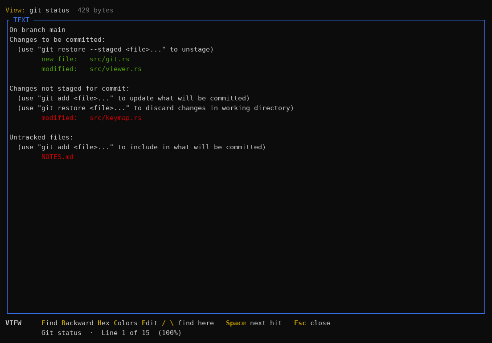
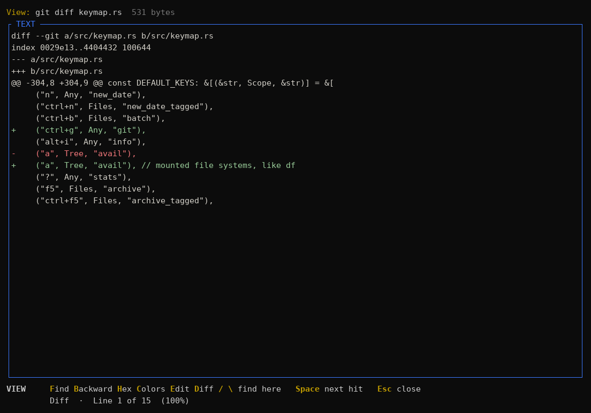
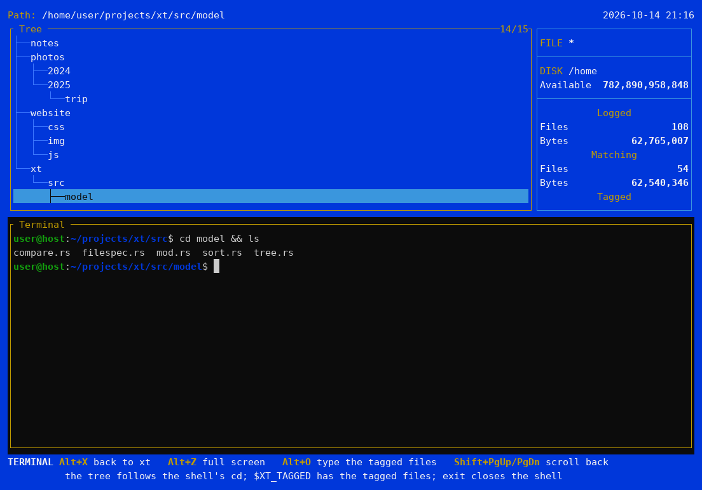

# Xylem

[Read in English](README.md)

Gerenciador de arquivos em modo texto para Linux, inspirado no XTree e no ZTreeWin.

O Xylem se chamava **xt** até a versão 0.1; o comando agora é `xy`. Na
primeira execução, ele move a configuração, o histórico e os bookmarks do xt
para as pastas novas. O nome: o xilema (*xylem*, em inglês) é o tecido que
leva a água pela árvore, e começa com X, como o XTree.


## Por que o Xylem?

Uso alguma variação do XTree desde a década de 1990, e o ZTreeWin continua
sendo, para mim, o melhor gerenciador de arquivos em modo texto. Desenvolvi o
Xylem por sentir falta de algo tão bom quanto ele rodando no Linux: as versões
que existem parecem estar abandonadas.

Apesar de gostar muito do ZTreeWin, a evolução dele é extremamente lenta. Por
isso, provavelmente o Xylem também terá uma versão para Windows.

O Xylem segue as teclas e o jeito de trabalhar do ZTreeWin sempre que possível;
as diferenças estão descritas em [Comparação com o ZTreeWin](#comparação-com-o-ztreewin).

## Aviso

O Xylem é um projeto independente, escrito do zero. Não tem ligação com a
Zedtek, Inc. (ZTreeWin) nem com os donos do XTree, nem é endossado por eles.
Não contém código desses programas; os nomes deles aparecem só para descrever
o que inspirou o Xylem e como ele se compara. XTree, ZTree e ZTreeWin são marcas
de seus respectivos donos.

## Telas

A árvore de diretórios, a janela de arquivos e as estatísticas, no tema clássico:


**Branch** (`B`) lista os arquivos de um ramo inteiro; os arquivos marcados
(`T`) ficam destacados e são contados à direita:


**Janela dividida** (F8), cada lado com seu próprio diretório:


**Visualizador** (`V`), com cores de sintaxe:


**Temas**: além do azul clássico, `dark`, `light`, `mono`, `norton`,
`solarized`, `gruvbox` (abaixo) e `nord`:


## Instalação

**Binário pronto:** baixe o arquivo do seu sistema na página de
[Releases](https://github.com/andrelnfernandes/xylem/releases): Linux x86_64 ou
ARM64 (estático, roda em qualquer distribuição) ou Windows x86_64. Extraia e
coloque o `xy` (`xy.exe`) numa pasta do `PATH`, por exemplo:

```bash
tar xzf xy-v0.2.0-x86_64-unknown-linux-musl.tar.gz
install -m 755 xy-v0.2.0-x86_64-unknown-linux-musl/xy ~/.local/bin/
```

Cada arquivo tem um `.sha256` ao lado, para conferir com `sha256sum -c`.

**Com o Cargo** (requer Rust, via [rustup](https://rustup.rs)), a partir do
[crates.io](https://crates.io/crates/xylem-fm), onde o Xylem se chama
`xylem-fm` (o nome `xylem` já era de outro projeto); o comando é `xy`:

```bash
cargo install xylem-fm
```

Ou o código mais recente, direto do GitHub, ou a partir de um clone do
repositório (na pasta do projeto):

```bash
cargo install --git https://github.com/andrelnfernandes/xylem
cargo install --path .
```

O binário vai para `~/.cargo/bin/xy` (que o rustup já coloca no `PATH`).
Para atualizar, rode o mesmo comando de novo; para remover, `cargo uninstall xylem-fm`.

**Atalho no menu (Linux, opcional):** para ter o Xylem no menu de
aplicativos do seu desktop, abrindo num terminal, rode isto num clone do
repositório. O `xy` precisa estar no `PATH` que o desktop enxerga
(`~/.local/bin` costuma estar; `~/.cargo/bin` nem sempre).

```bash
for s in 16 32 48 64 128 256 512; do
    install -Dm644 docs/icons/xylem-$s.png ~/.local/share/icons/hicolor/${s}x$s/apps/xylem.png
done
install -Dm644 docs/icons/xylem.svg ~/.local/share/icons/hicolor/scalable/apps/xylem.svg
install -Dm644 packaging/linux/xylem.desktop ~/.local/share/applications/xylem.desktop
```

## Uso

```bash
xy [diretório]
```

Sem argumento, abre o diretório atual. `xy --help` mostra as opções.

### Sair mudando o diretório do shell (Alt+Q)

Um programa não consegue mudar o diretório do shell que o chamou. Por isso,
como nos outros gerenciadores de arquivos, o **Alt+Q** grava o diretório
atual num arquivo (`--cwd-file`) e uma pequena função do shell faz o `cd`.
Coloque no `~/.bashrc` (ou `~/.zshrc`):

```bash
xy() {
    local tmp dir
    tmp=$(mktemp) || return
    command xy --cwd-file "$tmp" "$@"
    dir=$(cat -- "$tmp")
    rm -f -- "$tmp"
    [ -n "$dir" ] && [ -d "$dir" ] && cd -- "$dir"
}
```

Com ela, `xy` funciona como antes; só ao sair com **Alt+Q** o shell fica no
diretório em que você estava no Xylem. `Q` e F10 saem sem mudar nada.

## Windows (experimental)

O Xylem também compila para Windows (Windows Terminal ou o console clássico).
Ele passa nos testes automáticos lá, mas ainda não foi usado no dia a dia,
então espere arestas. Cada release tem um `xy.exe` pronto (veja
[Instalação](#instalação)), ou instale com o Cargo, do mesmo jeito.

O que muda no Windows:

- **Attributes** (`A`) edita R, H, S e A, como no ZTreeWin: `RA` define
  exatamente esses, `+H -A` liga ou desliga alguns. A lista de arquivos os
  mostra como `r-sa`.
- **Ocultos** são os arquivos e diretórios com o atributo H (um nome que
  começa com ponto é um nome comum).
- **eXecute** e **Edit** passam pelo `cmd`, com os nomes entre aspas duplas.
  Um `%NOME%` dentro de um nome de arquivo ainda é expandido pelo `cmd`.
- O editor padrão é o `notepad`, `O` usa o `start` e o Ctrl+B sugere
  `xy-batch.bat` (começando com `@echo off`).
- Apagar um arquivo somente leitura apaga o arquivo, como o `rm` no Linux.
- Copiar links simbólicos exige o Modo de Desenvolvedor ou direitos de
  administrador.
- Configuração em `%APPDATA%\xylem\config.toml`, histórico em
  `%LOCALAPPDATA%\xylem\`.
- O terminal embutido (Alt+X) roda o `cmd` (`%COMSPEC%`). Ao entrar nele, o
  shell ainda vai para o diretório da árvore, mas a árvore não acompanha os
  `cd`s do shell, e não há `$XY_TAGGED`.

Para o **Alt+Q** no PowerShell, coloque isto no seu `$PROFILE`:

```powershell
function xy {
    $tmp = New-TemporaryFile
    xy.exe --cwd-file $tmp @args
    $dir = Get-Content -Raw -Encoding UTF8 $tmp
    Remove-Item $tmp
    if ($dir -and (Test-Path -LiteralPath $dir -PathType Container)) {
        Set-Location -LiteralPath $dir
    }
}
```

## Configuração

A forma mais fácil é a **tela de configuração: F12** (ou Alt+F10, como no
ZTreeWin; no Ubuntu/GNOME o Alt+F10 costuma maximizar a janela e não chega ao
Xylem). Ela tem quatro páginas:

| Página | Opções |
|---|---|
| 1. Programas e formatos | editor, formato de data, formato de número, comandos Git |
| 2. Exibição e ordenação | mostrar ocultos, ordenação inicial e sentido, o que o Enter faz na janela de arquivos, modo inicial da janela de arquivos, cores de sintaxe no visualizador, cores do terminal embutido |
| 3. Confirmações e histórico | confirmar ao sair, confirmação do Prune, não guardar entradas com `@`, histórico próprio do terminal embutido |
| 4. Cópia, Compare e atualização | ignorar 2 s, ignorar 1 h, atualização automática, de onde partem os caminhos do Alt+C/Alt+M |

A letra da opção (ou Enter) troca o valor, PgUp/PgDn ou 1–4 mudam de página,
**F4** escolhe o tema numa lista (com prévia na hora), **F3** grava e aplica,
**Esc** desiste (pergunta se houver mudanças).

Tudo fica em `~/.config/xylem/config.toml` (ou `$XDG_CONFIG_HOME/xylem/`), que
também pode ser editado à mão; a tela mantém os seus comentários. Para começar
de um arquivo comentado com todos os padrões:

```bash
mkdir -p ~/.config/xylem && xy --default-config > ~/.config/xylem/config.toml
```

- `theme`: `classic` (azul do XTree), `dark`, `light`, `mono` (cores do
  próprio terminal), `norton`, `solarized`, `gruvbox` ou `nord`.
- `[options]`: as opções da tela de configuração.
- `[colors]`: troca cores individuais por cima do tema, com nomes
  (`"yellow"`), `"#rrggbb"` ou índices de 0 a 255.
- `[keys.any]`, `[keys.tree]`, `[keys.files]`: troca teclas, nas duas
  janelas ou só numa (esta tem prioridade). Ex.: `"f3" = "view"`,
  `"ctrl+r" = "relog"`; `"none"` desliga uma tecla. **F1** dentro do Xylem
  mostra as teclas em vigor, já com as suas trocas.

Um erro no arquivo não impede o Xylem de abrir: ele usa os padrões e mostra o
erro no rodapé (e a tela de configuração não grava até o arquivo ser
corrigido, para não apagar o que você escreveu).

## Git (opcional)

O Git não existe no XTree nem no ZTreeWin, por isso começa desligado: ligue
na **F12** (página 1, "Git commands") ou com `git = true` em `[options]`. É
preciso ter o programa `git`.

- **Ctrl+G** abre o menu Git no rodapé; a letra seguinte escolhe:
  - **S**tatus, **L**og, **D**iff (contra o HEAD: o que está e o que não está
    no stage, juntos, com cores) e **B**lame abrem no visualizador, com busca.
  - **A**dd e **U**nstage.
  - **C**ommit abre o editor do próprio Git, como o `git commit`.
- Os comandos agem sobre os arquivos marcados na lista, senão sobre o arquivo
  atual; na árvore, sobre o diretório atual. O Status sempre mostra o
  repositório inteiro.
- A lista de arquivos mostra o estado de cada arquivo antes do nome, com as
  duas letras do `git status --short`: `M ` no stage, ` M` alterado fora do
  stage, `A ` adicionado, `??` não rastreado, `R ` renomeado. Arquivos sem
  alteração ficam em branco. O estado é relido depois das operações do
  próprio Xylem, depois do F3 e a cada 10 segundos (para pegar commits feitos em
  outro terminal).
- No visualizador, **D** mostra o que mudou no arquivo desde o último commit
  (o `git diff HEAD` dele, com cores) e **D** de novo volta ao arquivo, no
  mesmo ponto. "Diff" só aparece no rodapé para arquivos com alterações; o
  **E** continua editando o arquivo, e o diff é atualizado na volta.
- Para push, pull e outros comandos que usam a rede, use o eXecute (`X`), por
  exemplo `git push`.

Letras de estado na lista de arquivos, com o menu Git aberto (Ctrl+G):


Status colorido, como no terminal (aqui com o tema `dark`):



**D** no visualizador: o que mudou no arquivo desde o último commit:



## Terminal embutido (Alt+X)

Não existe no XTree nem no ZTreeWin: o seu shell (`$SHELL`) rodando dentro da
tela do Xylem, na parte de baixo, com a árvore e os arquivos ainda visíveis em
cima.

Um `cd` no terminal leva a árvore junto:



Alt+O digita os arquivos marcados no prompt:


- **Alt+X** abre o terminal e volta ao Xylem. O shell continua rodando enquanto
  está escondido, com o histórico e o que estava na tela; `exit` fecha o
  shell.
- **Sair do Xylem encerra o shell** e o que estiver rodando nele. Se houver um
  programa rodando ali (um `vim`, por exemplo), Q e Alt+Q perguntam antes,
  mesmo com `confirm_quit` desligado (Linux e macOS).
- **Alt+Z** abre em tela cheia; dentro dele, alterna entre tela cheia e
  painel. Depois, o Alt+X reabre do jeito que estava.
- **A árvore acompanha o shell:** um `cd` no terminal leva o cursor da árvore
  para o mesmo diretório (Linux).
- **O shell acompanha a árvore:** ao entrar no terminal a partir de outro
  diretório, ele vai para lá. Isso só acontece com o shell parado no prompt;
  com um programa rodando (vim, less...), nada é digitado.
- **`$XY_TAGGED`** tem os arquivos marcados, atualizada ao entrar no terminal.
  É um array: no bash, use `"${XY_TAGGED[@]}"` (`cp "${XY_TAGGED[@]}" ~/backup`);
  no zsh e no fish, `$XY_TAGGED`. Com outros shells (sh, dash), só há o `cd`.
- **Alt+O** digita os arquivos marcados no cursor, entre aspas e relativos ao
  diretório do shell (`wc -l 'a.txt' 'b c.txt'`). Na árvore ou na janela de
  arquivos, abre o terminal e digita os nomes.
- **Shift+PgUp/PgDn** rolam pelo que saiu da tela.
- Ao sair do terminal, os diretórios abertos são relidos.
- **Histórico próprio:** os comandos digitados nele vão para um histórico do
  shell separado do dos seus outros terminais:
  `~/.local/state/xylem/bash_history` (`zsh_history`...), via `HISTFILE`; no fish,
  a sessão `xylem` (`fish_history`). Se o seu arquivo rc define `HISTFILE` sem
  condição, vale o dele. Desligue na **F12** (página 3) ou com
  `terminal_history = false`.
- Programas de tela cheia (vim, htop, less) funcionam dentro dele; todas as
  teclas vão para eles, menos Alt+X, Alt+Z e Alt+O.

As teclas podem ser trocadas em `[keys.any]` (`terminal`, `terminal_full`,
`terminal_tagged`): o Alt+T, por exemplo, é o menu "Terminal" em alguns
terminais. As cores são escolhidas na **F12** (página 2) ou em
`terminal_theme`, em `[options]`: `native` (as do terminal onde o Xylem roda),
`xylem` (fundo e texto do tema do Xylem), `solarized`, `gruvbox`, `nord`, `dracula`
ou `one_dark`.

Para mudar o diretório e o `$XY_TAGGED`, o Xylem grava um pequeno script numa
pasta própria (em `~/.cache/xylem/`, legível só por você) e digita
` . script` no prompt; o espaço no início deixa a linha fora do histórico no
bash (`ignorespace`) e no zsh (`HIST_IGNORE_SPACE`). Dentro do terminal,
`XY_TERMINAL=1`, para prompts e scripts que queiram saber.

## Teclas

### Navegação

| Tecla | Árvore | Janela de arquivos |
|---|---|---|
| ↑ ↓ PgUp PgDn Home End | move o cursor | move o cursor |
| → / `+` | expande o diretório | |
| ← / `-` | recolhe (ou vai para o pai) | página acima (em colunas: arquivo anterior) |
| → | expande | página abaixo (em colunas: próximo arquivo) |
| Alt+F | | modo de exibição: colunas de nomes, colunas com tamanho, detalhes, dono, tipo, nomes longos |
| Backspace | diretório pai | mostra os arquivos do diretório pai |
| Espaço | desce uma linha | idem |
| `*` | loga e expande o ramo inteiro | |
| `\` ou `/` | Treespec: vai a um diretório digitando o caminho | idem (no Branch/Showall: vai ao diretório do arquivo) |
| Shift+letra, 0–9 | próximo diretório que começa com ela | próximo arquivo que começa com ela |
| Alt+K | mostra o tamanho ou o nº de arquivos de cada diretório na árvore | idem |
| `B` | Branch: arquivos do ramo inteiro (loga antes) | idem |
| `S` | Showall: arquivos de tudo o que foi logado | idem |
| `F` | Filespec: filtro de arquivos | idem |
| Alt+S | ordena os arquivos: nome, extensão, data, tamanho; ordem | idem |
| F3 (ou F2) | relê o diretório do disco | idem |
| `V` | | visualiza o arquivo (texto/hex, com busca) |
| F7 | Autoview: lista com o conteúdo do arquivo selecionado ao lado | idem |
| Ctrl+S | | procura um texto nos marcados e desmarca os que não o têm |
| Ctrl+V | | visualiza os marcados em sequência |
| `O` | | abre o arquivo no programa padrão (`xdg-open`) |
| Ctrl+O | | abre os arquivos marcados no programa padrão |
| Alt+F5 | | abre um ZIP/TAR como diretório |
| `E` | | abre o arquivo no editor |
| `X` | executa um comando do shell | idem |
| Alt+X | terminal embutido (e volta ao Xylem) | idem |
| Alt+Z | terminal embutido em tela cheia | idem |
| Alt+O | terminal embutido, digitando os arquivos marcados | idem |
| `L` | Log: abre outro diretório na janela | |
| `C` | Compare: compara com a outra janela e marca | |
| F8 | divide a tela em duas janelas (ou volta a uma) | idem |
| Tab | troca de janela (tela dividida) | idem |
| Enter | abre a janela de arquivos | volta para a árvore |
| Esc | | volta para a árvore (no diretório do arquivo) |
| Alt+I | Info: detalhes do diretório (e o que está logado nele) | Info: detalhes do arquivo |
| `A` | Avail: sistemas de arquivos montados e espaço livre | |
| `?` | estatísticas da janela | idem |
| F1 / Alt+H | ajuda: lista das teclas em vigor | idem |
| F11 / Alt+B | gerenciador de marcadores de diretório (bookmarks) | idem |
| `'` | salto rápido para marcador (`0`-`9`, `a`-`z`, ou `'`/Enter para lista, `+` para adicionar) | idem |
| Ctrl+F11 / Ctrl+B | salvar marcador para a pasta atual | (na árvore: Ctrl+B / Ctrl+F11) |
| F12 / Alt+F10 | tela de configuração | idem |
| `Q` / F10 | sair (pede confirmação) | sair |
| Alt+Q | sai deixando o shell no diretório atual (veja acima) | idem |

### Tags e operações

| Tecla | Árvore | Janela de arquivos |
|---|---|---|
| `T` / `U` | marca / desmarca os arquivos do diretório | marca / desmarca o arquivo e desce |
| Ctrl+T / Ctrl+U | marca / desmarca tudo o que foi logado (filespec) | marca / desmarca a lista inteira |
| `I` | inverte as marcas do diretório | inverte as marcas da lista |
| Ctrl+F7 / F8 / F9 | marca / desmarca / inverte os arquivos logados do ramo | |
| `C` | | copia o arquivo |
| `M` | cria um subdiretório | move o arquivo |
| `D` / Del | apaga o diretório (só se vazio) | apaga o arquivo |
| Shift+Del | apaga definitivamente o diretório | apaga definitivamente o arquivo |
| `O` (árvore) / Ctrl+Z | restaura arquivo da lixeira (Oops!) | restaura arquivo da lixeira (Oops!) |
| Alt+P | Prune: apaga o diretório com tudo dentro | |
| `R` | renomeia o diretório | renomeia o arquivo |
| Ctrl+R / Alt+R | | renomeia os arquivos marcados por máscara/padrão |
| `A` | | permissões (octal, ex.: `644`) |
| `N` | muda a data do diretório | muda a data do arquivo (Ctrl+N: dos marcados) |
| Ctrl+B | | Batch: cria um script ou lista com uma linha por marcado |
| F5 / Ctrl+F5 | | cria um ZIP/TAR com o arquivo / com os marcados |
| Ctrl + `C` `M` `D` `A` | idem, nos arquivos marcados | idem, nos arquivos marcados |
| Alt+C | Compare do ramo inteiro | copia os marcados **recriando os caminhos** |
| Alt+M | | move os marcados **recriando os caminhos** |

As operações em grupo agem sobre os arquivos marcados **da lista atual**
(o diretório, ou o Branch/Showall aberto).

**Com ou sem caminhos:** Ctrl+C / Ctrl+M copiam ou movem os marcados todos
direto para o destino. Alt+C / Alt+M recriam no destino o caminho de cada
arquivo; de onde esse caminho parte depende do modo. Para
`/home/eu/proj/src/ops/mod.rs`, listado a partir de `src/ops` (a raiz da lista:
o diretório atual, a raiz do Branch, ou a raiz da árvore no Showall), copiado
para `destino`:

| Modo | Resultado | |
|---|---|---|
| Full | `destino/home/eu/proj/src/ops/mod.rs` | desde a raiz do disco, como no ZTreeWin (padrão) |
| Tree | `destino/src/ops/mod.rs` | desde a raiz da árvore do Xylem (aqui `proj`); não existe no ZTreeWin |
| Current | `destino/ops/mod.rs` | desde a raiz da lista, incluindo o nome dela |
| Relative | `destino/mod.rs` | só o que está abaixo da raiz da lista |

No prompt do destino, **F6** troca entre com e sem caminhos e **F7** alterna os
modos; os dois aparecem no próprio prompt. O modo com que o prompt começa é
escolhido na página 4 da F12 (`copy_paths`). Dentro de um pacote, os caminhos
partem no máximo da raiz do pacote. Alt+D e Alt+A funcionam como Ctrl+D e
Ctrl+A.

**Escolher a pasta (F2):** em qualquer prompt que pede uma pasta (Copy, Move,
Log e a pasta do Ctrl+B e do F5), o **F2** abre uma árvore para escolhê-la,
como no ZTreeWin. Ela começa na pasta já digitada; as teclas da árvore
navegam (os diretórios são lidos conforme são abertos), o **Tab** passa para
a árvore da outra janela com a tela dividida, o **Enter** põe a pasta no
prompt (Ctrl+B e F5 mantêm o nome do arquivo) e o **Esc** volta sem alterar
nada. Nada é executado até você confirmar o prompt.

**Renomeação em lote por máscara (Ctrl+R / Alt+R):** renomeia todos os arquivos marcados usando padrões:
- **Curingas (Wildcards):** `*.jpg` (muda a extensão), `prefixo_*.*`, `*_sufixo.*`, `???.*` (máscara de caracteres).
- **Localizar e substituir:** `s/antigo/novo/` ou `s/antigo/novo/i` (substitui `antigo` por `novo`, `/i` ignora maiúsculas/minúsculas).
- **Numeração incremental:** `%03d`, `%02d`, `%d`, `<001>`, `<01>`, ou `<#>` (numera os arquivos marcados em sequência).
- **Conversão de maiúsculas/minúsculas:** pressione **F2** no prompt para alternar entre Nenhuma, minúsculas, MAIÚSCULAS e Iniciais Maiúsculas (Title Case), ou use as tags `<lower>`, `<upper>`, `<title>`.


**Tela dividida:** F8 abre uma segunda janela, começando no mesmo diretório;
Tab alterna entre elas (sem a divisão, Tab faz o mesmo que Enter). Cada janela
tem a sua árvore, cursor e filespec; use `L` para abrir outro diretório nela.
Com a tela dividida, o Copy/Move sugere como destino o diretório da outra
janela, e as duas são atualizadas depois de qualquer operação.

**Compare (`C` na árvore, com a tela dividida):** compara os arquivos do
diretório atual com os do diretório da outra janela e marca, à escolha:
**U**nique (não existem do outro lado), **N**ewer, **O**lder, **I**dentical
(mesmo tamanho e data), **D**ifferent, ou **A**ll new (únicos + mais novos:
o que falta copiar para atualizar o outro lado). **B** (ou Alt+C na árvore,
como no ZTreeWin) troca o escopo para o
ramo inteiro: o Xylem loga o ramo, compara seguindo os caminhos relativos
(`src/a.rs` ↔ `<outro>/src/a.rs`) e abre o Branch com os arquivos marcados.
Datas com até 2 segundos de diferença contam como iguais (FAT/exFAT).

Para sincronizar: `C` `B` `A` e depois Alt+C (copiar com caminhos), que já
sugere a outra janela como destino.

**Ordenação (Alt+S):** **N**ame, **E**xt, **D**ate ou **S**ize; **O**rder
alterna crescente/decrescente e **P**ath first agrupa por diretório no
Branch/Showall. A ordem atual aparece no título da janela de arquivos (ex.:
`Size↓`) e o cursor fica no mesmo arquivo. A ordem inicial vem de `sort` e
`sort_descending` na configuração; novas janelas (F8, Log) herdam a atual.

**Treespec (`\` ou `/`):** abre um prompt com o caminho atual; enquanto você digita,
o cursor da árvore vai para o primeiro diretório que começa com o que foi
digitado (sem diferenciar maiúsculas). `/` ou `\` completam o nome e descem
um nível; Tab e Shift+Tab completam e depois passam para o próximo/anterior
diretório do mesmo nível; Backspace volta níveis; Enter confirma; Esc volta
para onde estava. ↑ traz o histórico (salvo entre execuções). Um caminho fora
da árvore vira um Log ao confirmar. No Branch/Showall, `\` vai direto ao
diretório do arquivo selecionado, com ele em destaque.

**Modos de exibição (Alt+F):** alterna, na ordem do ZTreeWin, entre
**nomes em várias colunas**, **nomes e tamanhos em colunas**, **detalhes**
(uma coluna com tamanho, data e permissões, o padrão) e **nomes longos** (uma
coluna, só os nomes inteiros). Antes dos nomes longos vêm dois modos que o
ZTreeWin não tem: **dono** (tamanho, `usuário:grupo` e permissões; não
aparece no Windows nem dentro de arquivos compactados) e **tipo** (o que cada
arquivo é, no espírito do comando `file`: "PNG image, 800 x 600", "ELF 64-bit
executable", "python3 script", "Rust, UTF-8 text"..., a partir dos primeiros
bytes dos arquivos visíveis). Nos modos de colunas, os arquivos seguem da
esquerda para a direita, ← → andam um arquivo e ↑ ↓ uma linha; nomes com mais
de 20 caracteres são cortados com `…`. O modo inicial fica em `file_display`
(página 2 da configuração).

**Autoview (F7):** divide a tela entre a lista de arquivos e o conteúdo do
arquivo selecionado, que acompanha o cursor. As teclas da janela de arquivos
continuam valendo (T marca, por exemplo); Shift+↑/↓/PgUp/PgDn/Home/End
rolam o conteúdo; F7, Esc ou Enter saem. Mostra o primeiro 1 MiB de cada
arquivo (o V mostra até 16 MiB).

**KByte (Alt+K):** mostra à direita de cada diretório da árvore o
**S**ize (total em K) ou o **C**ount (nº de arquivos); **N**one desliga.
Antes de escolher, **A**ll/**T**agged contam todos ou só os marcados, e
**B**ranch/**D**irectory somam o ramo inteiro ou só o diretório. Diretórios
ainda não logados mostram `?`. Cada janela tem a sua escolha.

**Edit e eXecute:** `E` abre o arquivo no editor (`$VISUAL`, `$EDITOR`, o
`editor` do Debian/Ubuntu ou `vi`). `X` pede uma linha de comando e a roda com
`sh` no diretório atual; `%f` vira o arquivo sob o cursor, `%t` os arquivos
marcados e `%d` o diretório atual, todos já entre aspas (`%%` é um `%`).
Exemplo: `tar czf backup.tgz %t`. No fim, o Xylem espera Enter para você ler a
saída. Ao voltar, os diretórios abertos são relidos.

**Histórico:** nos prompts, ↑/↓ trazem as entradas anteriores. Cada tipo de
prompt (Filespec, destino do Copy/Move, Log, eXecute...) tem o seu histórico,
guardado em `~/.local/state/xylem/history.toml` (ou `$XDG_STATE_HOME/xylem/`), com
permissão só para você, já que pode conter comandos digitados.

**Open (`O`):** abre o arquivo no programa padrão do sistema (`xdg-open`:
imagens no visualizador de imagens, PDFs no leitor de PDF etc.), em
segundo plano, sem sair do Xylem. Ctrl+O abre todos os marcados. Dentro de um
arquivo compactado, a entrada é extraída antes para uma pasta temporária,
apagada ao sair do Xylem. Outro programa pode ser escolhido em `opener` (ou na
tela de configuração).

**Arquivos compactados:** Alt+F5 na janela de arquivos abre `.zip` (também
`.jar`, `.war`, `.apk`), `.7z` e `.tar`, puro ou comprimido com gzip
(`.tar.gz`, `.tgz`), xz (`.tar.xz`, `.txz`), bzip2 (`.tar.bz2`, `.tbz2`) ou
zstd (`.tar.zst`), como uma árvore, somente leitura (arquivos 7z
criptografados não são suportados):
navegação, Filespec, Branch, Showall, tags, View e Compare funcionam dentro
dele, e Copy (inclusive Ctrl+C e Alt+C com caminhos) extrai os arquivos.
`Esc` na árvore fecha o arquivo e volta para onde estava. Por segurança,
entradas com `..` ou caminho absoluto são ignoradas, e links simbólicos
dentro de arquivos compactados nunca são extraídos.

**Atualização automática:** o Xylem observa (via inotify) o diretório atual de
cada janela e relê sozinho quando outro programa cria, apaga, renomeia ou
altera arquivos ali, mantendo o cursor no mesmo arquivo. As mudanças são
agrupadas (no máximo uma releitura a cada meio segundo) e esperam o fim de
uma operação em andamento. Outros diretórios continuam com F3.

**Menus Ctrl/Alt:** como no ZTree, o rodapé mostra só os comandos de uma
tecla. **F9** alterna para o menu de Ctrl, depois o de Alt, e volta. Com um
desses menus aberto pelo F9, a próxima letra vale como Ctrl+letra ou
Alt+letra (ex.: `F9` `M` = Ctrl+M); `Esc` desiste. Nos terminais com o
protocolo de teclado do kitty, basta **segurar Ctrl ou Alt** para o menu
correspondente aparecer enquanto a tecla estiver pressionada.

**Ctrl+M:** na maioria dos terminais, Ctrl+M chega igual a Enter. O Xylem liga
automaticamente o protocolo de teclado do kitty quando o terminal o suporta
(kitty, WezTerm, foot, Ghostty, Alacritty recente, iTerm2), e aí Ctrl+M move
os arquivos marcados como no ZTree. Nos terminais baseados em VTE (GNOME
Terminal, Ptyxis, Terminator, Tilix) use **F9 M** (ou Alt+M e F6 no prompt).

Durante um log demorado, o progresso aparece no rodapé e `Esc` cancela.

**Filespec (`F`):** especificações separadas por espaço, `;` ou `,`, de três
tipos, como no ZTreeWin:

- **nome:** glob (`*.rs`, `a?c*`, `[abc]*`), sem diferenciar maiúsculas;
  entre aspas, o nome pode ter espaços (`"meu arquivo*"`);
- **data:** `<`, `=`, `>`, `<=`, `>=` ou `<>` e uma data na ordem do formato
  configurado, com `/`, `.` ou `-` e ano de 2 ou 4 dígitos (`>01/05/2026`;
  `2026-05-01` sempre vale), ou `TODAY` e `TODAY-n` (`>TODAY-7`: últimos 7
  dias);
- **tamanho:** o mesmo com `s` depois do operador (`>=s200000`); no Xylem
  também valem K, M e G (`>s100M`).

Um `-` na frente nega (`-*.bak`; `-<s1K` é o mesmo que `>=s1K`). Dentro de
cada tipo, as especificações positivas valem com "ou", exceto `>a` logo
seguido de `<b`, que é a faixa entre os dois (`>=01/05/2026,<=31/05/2026`:
maio); `<>` exclui. Entre os tipos vale "e": `*.txt,=TODAY,<s1000` são os
`.txt` de hoje com menos de 1000 bytes.

**Copy/Move:** o destino pode ser um diretório (relativo ao diretório do
cursor da árvore, absoluto ou com `~`) ou, para um único arquivo, um novo
nome. Uma pasta de destino que ainda não existe é criada depois que você
confirma. Se o arquivo de destino já existe, o Xylem pergunta: Yes / No / All
/ Skip all, mostrando o tamanho e a data dos dois arquivos e se o existente é
mais novo ou mais antigo, maior ou menor. A cópia é feita num temporário que
só substitui o destino no fim: cancelar (`Esc`) ou um erro nunca deixa um
arquivo pela metade. Permissões e data de modificação são preservadas, e links
simbólicos são copiados como links. Mover entre discos copia e depois apaga.

**New date (`N`):** muda a data de modificação. O prompt já vem com a data
atual no seu formato; aceita também `now` e `today`. Só com a data (sem
`HH:MM`), cada arquivo mantém a sua hora. Links simbólicos são pulados (a
data mudaria a do arquivo para onde apontam).

**Batch (Ctrl+B):** pede o nome do arquivo a criar e uma máscara de linha,
e escreve uma linha por arquivo marcado. Parâmetros: `%f` caminho, `%d`
diretório, `%n` nome, `%b` nome sem extensão, `%e` extensão, `%s` tamanho.
Em minúsculas saem entre aspas, seguros para o shell (`convert %f %b.png`);
em maiúsculas, como texto puro, para listas (`%N;%S`). Um arquivo `.sh`
ganha `#!/bin/sh` e permissão de execução (rode-o com `X`). Um arquivo que
já existe não é sobrescrito.

**Criar compactado (F5 / Ctrl+F5):** cria um `.zip`, `.tar`, `.tar.gz` ou
`.tgz` (pelo nome digitado) com o arquivo atual ou com os marcados. Os
caminhos lá dentro são relativos à raiz da lista, como no Alt+C: num Branch,
as subpastas são mantidas. Tem progresso e `Esc` cancela; o arquivo é escrito
num temporário e só ganha o nome no fim, então nunca fica pela metade. Links
simbólicos entram como links. Um arquivo que já existe não é sobrescrito.

**Info, Avail e estatísticas:** Alt+I mostra tipo, tamanho, permissões,
dono e grupo, datas (modificação, acesso e mudança), inode, links e
dispositivo do arquivo ou diretório (de um link, para onde aponta; de um
diretório, também o que está logado nele e no ramo). `A` na árvore lista os
sistemas de arquivos montados com total, usado, livre e % de uso, como o
`df`. `?` resume a janela: o que está logado, a lista, os marcados e o disco
(ponto de montagem, livre e usado); abaixo, a máquina (sistema e kernel, CPU,
tempo ligado, carga, memória e swap, shell, terminal), a rede (endereços IP
de cada interface, gateway e DNS) e o próprio Xylem (versão, PID, memória em uso,
executável e arquivo de configuração).

**Delete e Lixeira:** `D` ou `Del` sempre pede confirmação antes de apagar. Quando `delete_to_trash = true` na configuração (ou pressionando `T` na confirmação), arquivos e diretórios vazios são enviados para a lixeira do sistema (FreeDesktop Trash no Linux, Lixeira no Windows) em vez de apagados de vez. `Shift+Del` apaga de forma permanente. Caso tenha enviado algo para a lixeira por engano, a função **Oops** (`O` na árvore, ou `Ctrl+Z` em ambas as janelas) permite restaurar o item para a sua localização original.

**Prune (Alt+P na árvore):** loga o ramo inteiro, mostra quantos arquivos,
diretórios e bytes serão apagados e pede que você **digite PRUNE** (ou o nome
do diretório, ou Y, conforme `prune_confirmation`). Apaga os arquivos e depois
os diretórios, do mais fundo para cima, com progresso e `Esc` para cancelar.
Links simbólicos são removidos sem seguir o destino, e **outros pontos de
montagem dentro do ramo são pulados** (um pendrive montado ali dentro não é
apagado). A raiz da árvore não pode sofrer Prune.

**Cores de sintaxe:** o visualizador colore código-fonte e scripts em cerca de
150 linguagens (Rust, Python, shell, C, JavaScript, SQL, YAML, Markdown...),
reconhecidas pela extensão, pelo nome (`Makefile`) ou pela primeira linha
(`#!/bin/bash`). **C** liga e desliga as cores durante a visualização; o
padrão é `syntax_highlight` (página 2 da configuração). As cores são ajustadas
para ficarem legíveis no fundo do tema atual, inclusive o azul clássico. Só as
primeiras 20.000 linhas são coloridas, para arquivos enormes não deixarem o
visualizador lento.

**Visualizador:** setas/PgUp/PgDn/Home/End rolam, ←→ deslocam na horizontal,
`H` alterna texto/hex, **E** abre o arquivo no editor configurado (de volta ao
Xylem, o visualizador mostra o conteúdo novo no mesmo ponto; não vale para
arquivos dentro de pacotes), `Esc` fecha. Arquivos binários abrem em hex.
Arquivos acima de 16 MiB mostram só o começo. Busca, como no ZTreeWin:
**F** procura do início, **B** para trás a partir do fim, **/** (ou S) a
partir da página atual e **\\** para trás a partir dela; **Espaço**
continua na mesma direção, **+** e **-** escolhem a direção. O trecho achado
fica destacado.

**Procurar nos marcados (Ctrl+S) e visualizá-los (Ctrl+V):** Ctrl+S procura
um texto em todos os arquivos marcados da lista e **desmarca os que não o
contêm**, com progresso e `Esc` para parar. Ctrl+V abre os que sobraram no
visualizador, um depois do outro: **N**ext e **P**rev trocam de arquivo
(Alt+Home/Alt+End: primeiro/último) e **U** desmarca o atual. O termo é o
mesmo nas duas buscas: depois de um Ctrl+S, o **Espaço** no Ctrl+V já vai
para o próximo trecho, passando para o próximo marcado quando o arquivo
acaba. Nos prompts de busca, **F2** liga/desliga diferenciar maiúsculas
(sem diferenciar, acentos também contam: `AÇÃO` acha `ação`) e **F4** troca
entre texto e hex (pares como `4d 5a`). Um `*` no meio do termo casa
qualquer coisa na mesma linha (`erro*disco`); um termo nunca atravessa uma
quebra de linha. Funciona também dentro de ZIP/TAR.

Na árvore, `+` no conector (`├─+`) indica um diretório recolhido que tem subdiretórios.

## Estrutura

- `src/model/` — árvore de diretórios em memória (arena), sem dependência da UI
- `src/app/` — estado global (prompts, operações) e execução de comandos
- `src/pane.rs` — uma janela: árvore, lista de arquivos, cursores e filespec
- `src/input.rs` — comandos e o campo de texto dos prompts
- `src/keymap.rs` — teclas padrão, trocas da configuração e ajuda (F1)
- `src/ui.rs` — desenho da tela (ratatui)
- `src/viewer.rs` — visualizador texto/hex
- `src/archive.rs` — leitura de ZIP/TAR
- `src/watch.rs` — avisos de mudanças no disco (inotify)
- `src/shell.rs` — editor e comandos do shell (com aspas seguras)
- `src/term.rs` — terminal embutido (pseudoterminal, códigos de teclas, cores)
- `src/git.rs` — menu Git (Ctrl+G) e marcadores de estado, pelo programa `git`
- `src/config.rs` — arquivo de configuração, temas e formatos
- `src/settings.rs` — tela de configuração (F12)
- `src/state.rs` — histórico dos prompts entre execuções
- `src/model/compare.rs` — regras do Compare
- `src/model/filespec.rs` — filtro de arquivos
- `src/ops/` — copiar, mover e apagar, em passos (progresso, conflitos, cancelamento)
- `docs/screenshots/tools/` — refaz as capturas de tela do README (`run.sh`, Linux)
- `docs/icons/` — o ícone, em SVG, PNG (16 a 512) e ICO
- `build.rs` — embute o ícone no `xy.exe` (Windows)
- `packaging/linux/` — atalho para o menu (`xylem.desktop`)

## Roteiro

- [x] Fase 0 — tela clássica, árvore navegável, janela de arquivos
- [x] Fase 1 — Filespec, Showall/Branch, viewer texto/hex, log com progresso
- [x] Fase 2 — tagging, copy/move/delete/rename, makedir, permissões, re-log
- [x] Fase 3 — janela dividida (F8), Log, Compare, ZIP/TAR, inotify, Edit,
  eXecute, histórico nos prompts
- [x] Fase 4 — configuração, temas, teclas configuráveis, ajuda (F1),
  histórico persistente, build de release e instalação

### Para depois

- pacote `.deb` (falta definir licença e mantenedor)
- versão para Windows: compila e passa nos testes (veja
  [Windows (experimental)](#windows-experimental)); falta usar no dia a dia.
  Talvez macOS
- os itens de "Não implementado" abaixo

## Comparação com o ZTreeWin

Levantamento feito comando a comando a partir do manual oficial do ZTreeWin
v2.2 ([ztwhlp.pdf](https://www.zedtek.com/download/ztwhlp.pdf), de 2011, em
especial a "Quick Command Table" e a seção 3.7 de configuração). Versões mais
novas do ZTreeWin podem ter mudado detalhes.

### Implementado

Árvore com log sob demanda (`+`, `*`), janela de arquivos, Filespec, Branch,
Showall, tags (T, U, I, Ctrl+T/U), Copy/Move/Delete/Rename com as versões
Ctrl (marcados) e Alt (marcados com caminhos), Make dir, Delete dir, Prune,
Attributes, View, Edit, eXecute, Compare (diretório e ramo), Sort, Log,
janela dividida (F8 e Tab), relog (F3), Open (`O`), atualização automática, navegação e
extração de arquivos compactados, histórico nos prompts, ajuda (F1) e tela de
configuração (Alt+F10).

### Simplificado

| Recurso | No ZTreeWin | No Xylem |
|---|---|---|
| Filespec | nome com regras próprias de nome e extensão, data, tamanho, atributo, filespec invertido (Ctrl+I), rótulos | glob para os nomes, data e tamanho como no ZTreeWin (com K/M/G); sem atributos, inversão e rótulos |
| Visualizador | modos Alpha, Dump, Hex, Junk e Wrap; conjuntos de caracteres; edição hex; marcadores; auto-scroll | texto (UTF-8) ou hex, com a busca do ZTreeWin (F, B, /, \\, Espaço, + e -), cores de sintaxe (que o ZTreeWin não tem), sem quebra de linha; até 16 MiB |
| Ctrl+S | texto, hex ou Unicode; busca só no índice de ZIPs | texto ou hex |
| Attributes | atributos do Windows (R, A, S, H) | permissões do Unix em octal (`644`); sem dono/grupo. No Windows, R, H, S e A, como no ZTreeWin |
| Sort | Name, Ext, Date, Time, Length, Alpha, nuMber, Size, Value, Unsorted; Charset; same/diff na tela dividida | Name, Ext, Date, Size, crescente/decrescente, Path first; cada janela tem a sua ordem |
| Compare | opções Identical, Unique, Newer, Older, Size, Binary, Case; filtro de exibição | marca únicos, mais novos, mais antigos, idênticos, diferentes ou únicos+mais novos; sem comparação binária |
| Prune | apaga só os subdiretórios ou também o atual; só diretórios vazios; lixeira | apaga sempre o diretório inteiro, permanentemente; confirmação configurável |
| Delete | lixeira opcional | lixeira opcional (via delete_to_trash ou alternância T/P no prompt; Shift+Del definitivo) com restauração Oops (O/Ctrl+Z) |
| Log | vários drives logados, Global, troca de drive | uma raiz por janela; `L` abre outro diretório |
| eXecute | parâmetros de batch `%1`–`%8`, nova janela (NTW) | `sh` com `%f`, `%t` e `%d`; sempre no terminal do Xylem; também um terminal embutido (Alt+X) |
| Histórico | janela de histórico com marcadores | ↑/↓ no prompt, um histórico por tipo, salvo entre execuções |
| Configuração | 7 páginas, editor de cores (F4) por elemento, Alt-Export | 4 páginas com as opções que fazem sentido no Linux; F4 escolhe entre 8 temas prontos; cores individuais no `config.toml` |
| Arquivos compactados | qualquer formato com archiver externo, criar (F5), extrair (Alt-F5) | ZIP/JAR/WAR/APK, 7z, TAR (puro, gzip, xz, bzip2, zstd): abrir (Alt+F5), extrair com Copy, criar com F5 (ZIP, TAR e TAR.GZ) |
| Tela dividida | painéis de estatísticas opcionais por lado | sem painel de estatísticas |
| Menus | menu de Ctrl/Alt ao segurar a tecla | igual em terminais com o protocolo do kitty; F9 em qualquer terminal |

Opções de configuração do ZTreeWin que não foram trazidas por serem do
Windows: atributos RSH, lixeira, junctions, OEM/ANSI, EBCDIC, tamanho da
janela, atalhos (.lnk). As demais dependem de recursos ainda não feitos
(abaixo).

### Teclas diferentes

As teclas seguem as do ZTreeWin. As exceções:

| Função | ZTreeWin | Xylem |
|---|---|---|
| Ajuda | F1 | F1 ou Alt+H (no GNOME Terminal, F1 abre a ajuda do terminal) |
| Configuração | Alt+F10 | F12 ou Alt+F10 (no GNOME, Alt+F10 maximiza a janela e não chega ao Xylem) |
| Marcadores | F11 | F11, Alt+B ou apóstrofo `'` (no GNOME Terminal, F11 alterna tela cheia) |
| Mover marcados | Ctrl+M | Ctrl+M em terminais com o protocolo do kitty; nos outros, `F9` `M` (ou Alt+M e F6) |
| `-` na árvore | descarrega o ramo da memória | só recolhe (continua logado) |
| F2 | (nada) | relê o diretório, igual ao F3 |
| F9 | menu de aplicativos (não implementado) | menus de Ctrl/Alt |
| F12 | macros (não implementadas) | configuração |
| `/` | o mesmo que `?` (estatísticas) | Treespec, como `\` (`?` continua mostrando as estatísticas) |
| Ctrl+C, Ctrl+M na árvore | (nada) | Copy/Move dos marcados do diretório atual |
| Copiar caminho para área de transferência | Ctrl+Insert | Y ou Ctrl+Insert (Ctrl+Y para marcados; suporta OSC 52 e clipboard do sistema) |

Todas as teclas podem ser trocadas em `[keys]` no `config.toml`.

### Não implementado

- **Árvore:** Global (G), Graft (Alt+G), Mirror (Alt+M), Oops
  (O, recuperar apagados), Release/descarregar da memória (Alt+R, `-`,
  Ctrl+Backspace), Hide (Alt+H), Wash (Alt+W), Volume
  (Ctrl+V), F5/F6 (esconder níveis de subdiretórios),
  marcar por atributo (Alt+T/U),
  Treespec em modo de edição (F5, curingas) e pastas especiais (F6), busca
  ao digitar com prompt (`|`) e modo ativo, troca de drive (`<` e `>`).
- **Arquivos:** Open em nova janela de terminal (Alt+O), Batch do arquivo atual (Alt+B), JFC (J, comparar o conteúdo de dois arquivos), ZAAP
  (descompactador externo), sHortcut (H), Print (P),
  dono/grupo (chown), Megaview (Ctrl+F7 na janela de arquivos), juntar marcados entre as
  janelas (Ctrl+F6), Partial Untag (Ctrl+F8).
- **Geral:** macros (F12), menu de aplicativos (F9), Quit and shell (Ctrl+Q), salvar e
  carregar o log (Zlist, Ctrl/Alt+Z), lixeira, cores por nome e atributo
  (ZCOLORS.INI), mouse, opções de linha de comando do ZTreeWin, comandos de
  vídeo (Alt+F6–F9).

## Licença

O Xylem é distribuído sob a [licença MIT](LICENSE).
