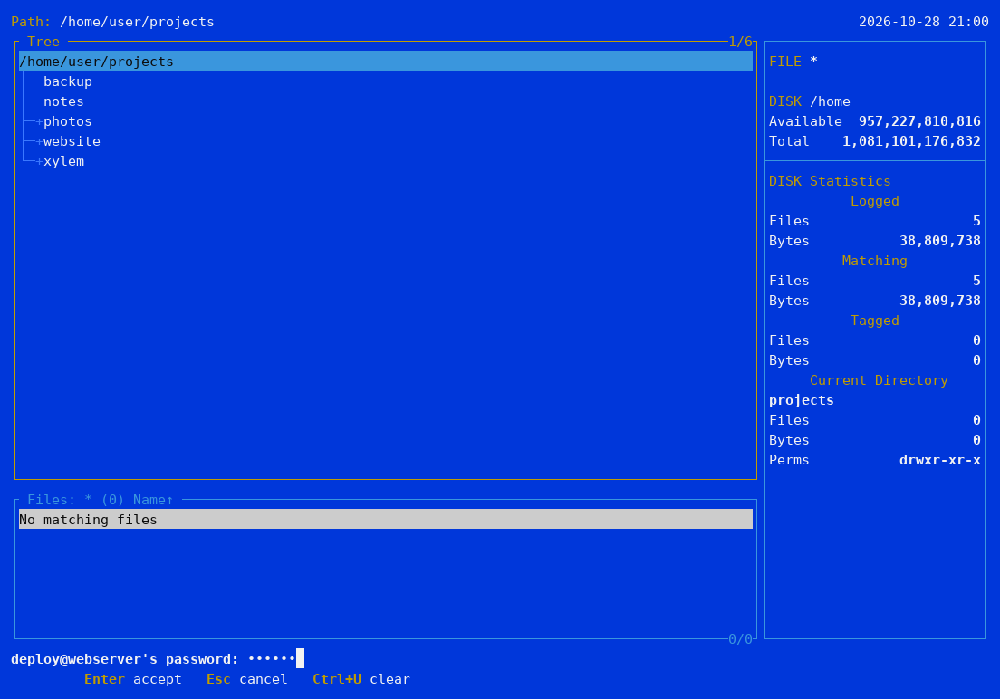
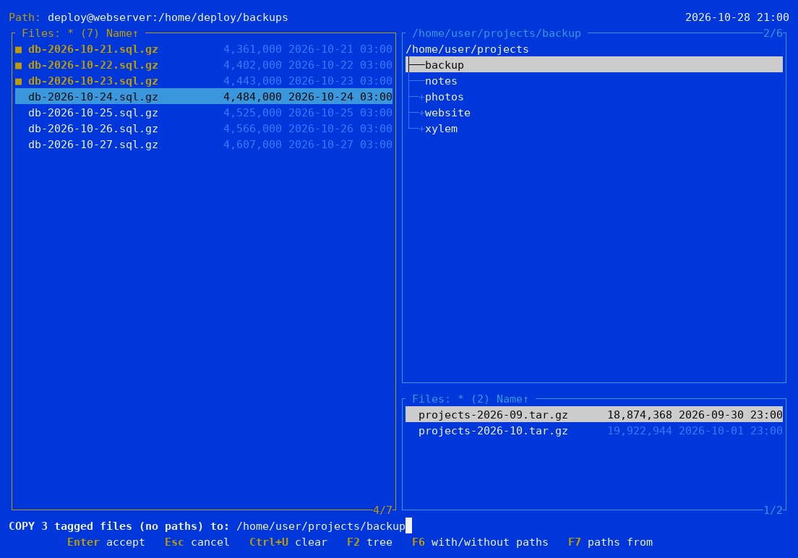
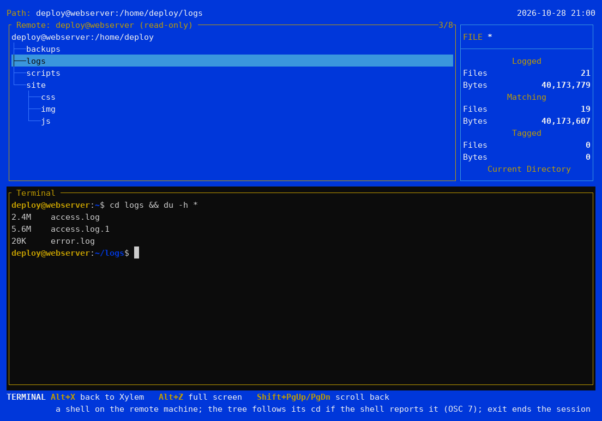

# Máquinas remotas (SSH)

Xylem puede mostrar los archivos de otra máquina, accesible por SSH, como un
árbol: sola o con esta máquina al lado en [pantalla dividida](split.md).

## Abrir una

Escribe la dirección en `L` ([Log](treespec.md)) o pásala a `xy` en la línea de
comandos:

- `user@host:` — el directorio personal; `user@host:/srv/www` — ese directorio;
- `ssh://[user@]host[:port][/path]` — con un puerto o sin usuario (como en tu
  `~/.ssh/config`).

Xylem ejecuta tu propio `ssh`, así que lo que usas en una terminal funciona
igual: `~/.ssh/config` (alias de hosts, puertos, ProxyJump), claves, el agente y
`known_hosts`. No hace falta instalar nada en la otra máquina: Xylem habla SFTP,
que viene en cualquier servidor SSH (Linux, BSD, macOS, Windows).

## Contraseñas y preguntas

Cuando ssh pide algo, la pregunta aparece en el pie de página:

- una **contraseña** o la **frase de paso** de una clave: se escribe oculta;
  Enter la envía, Esc abandona la conexión. Xylem se la pasa a ssh y no guarda
  nada.
- un **host desconocido**: el host y la huella de su clave, para comprobarla
  antes de responder `yes` (ssh la recuerda luego en `known_hosts`, como de
  costumbre).

`Esc` mientras se conecta cancela. Con una clave y el agente, no se pregunta
nada.



## Qué funciona

El árbol, la ventana de archivos, [Filespec](filespec.md), Branch, Showall, las
marcas, [el visor](viewer.md), [Ctrl+S y Ctrl+V](search.md), Autoview, Info
(Alt+I), los modos de visualización (propietario muestra los identificadores de
usuario y grupo, que es lo que envía SFTP), [Comparar](compare.md) y Abrir (`O`
descarga una copia y la abre aquí).

**Copiar** trae archivos a esta máquina, con sus permisos y fechas (al segundo,
tal como los guarda SFTP); con la pantalla dividida, sugiere la ventana de esta
máquina como destino. Alt+C (con rutas) también funciona, con rutas que empiezan
en la raíz de la ventana remota.



Por ahora el lado remoto es de **solo lectura**: Mover, Eliminar, Renombrar,
crear directorios, Atributos, fechas, Editar, eJecutar y copiar *hacia* la
máquina remota aún no están disponibles. F3 vuelve a leer un directorio; no hay
actualización automática.

**F8** en una ventana remota abre una ventana en esta máquina (la carpeta donde
se inició Xylem), para tener ambas lado a lado.

## La terminal en la máquina remota

**Alt+X** en una ventana remota abre una shell en esa máquina (`ssh -t`),
empezando en el directorio de la ventana; en una ventana local, la shell local,
como antes (cada una sigue ejecutándose mientras la otra está en pantalla). En
Linux y macOS la shell remota reutiliza la conexión ya establecida, por lo que
no vuelve a pedir la contraseña; en Windows, ssh la pide en la terminal.



El árbol sigue los `cd` de la shell remota cuando la shell informa de su
directorio mediante la secuencia OSC 7. Muchos sistemas ya lo hacen; para bash,
añade esto a `~/.bashrc` **en la máquina remota**:

```bash
PROMPT_COMMAND='printf "\033]7;file://%s%s\007" "$HOSTNAME" "$PWD"'
```

Xylem nunca escribe en una shell remota (no puede saber si hay un programa en
ejecución allí), y Alt+O y `$XY_TAGGED` son solo para terminales locales. Salir
con una terminal remota abierta pregunta antes.

## tmux o screen iniciados al entrar

Algunas personas inician tmux (o screen) automáticamente al entrar por SSH,
desde `~/.bashrc` en la máquina remota, para que si se cae la conexión (un Wi-Fi
inestable, una VPN que se reconecta) no muera lo que se estaba ejecutando: al
volver a entrar se retoma la misma sesión. Por ejemplo:

```bash
if [ -n "$SSH_CONNECTION" ] && [ -z "$TMUX" ]; then
    tmux attach-session -t remote 2>/dev/null || tmux new-session -s remote
fi
```

En ese caso, la terminal remota de Xylem también se abre dentro de tmux. Todo
funciona, salvo que **el árbol no sigue los `cd` de la shell**: tmux se sitúa
entre la shell y Xylem, se queda la secuencia OSC 7 y no la reenvía.

La shell remota de Xylem arranca con `XY_TERMINAL=1` definida, igual que la
local, de modo que el inicio de sesión puede distinguir ambas. Añadir esa
comprobación a la condición mantiene tmux para tu `ssh` habitual y lo omite
cuando conecta Xylem:

```bash
if [ -n "$SSH_CONNECTION" ] && [ -z "$TMUX" ] && [ -z "$XY_TERMINAL" ]; then
    tmux attach-session -t remote 2>/dev/null || tmux new-session -s remote
fi
```

Dentro de Xylem la shell no necesita tmux para sobrevivir: sigue ejecutándose
mientras Xylem está abierto, y si la conexión se cae, la ventana remota cae con
ella de todos modos.

Para Google Drive, S3 y otros servicios de almacenamiento en la nube, véase
[Almacenamiento en la nube](cloud.md).
